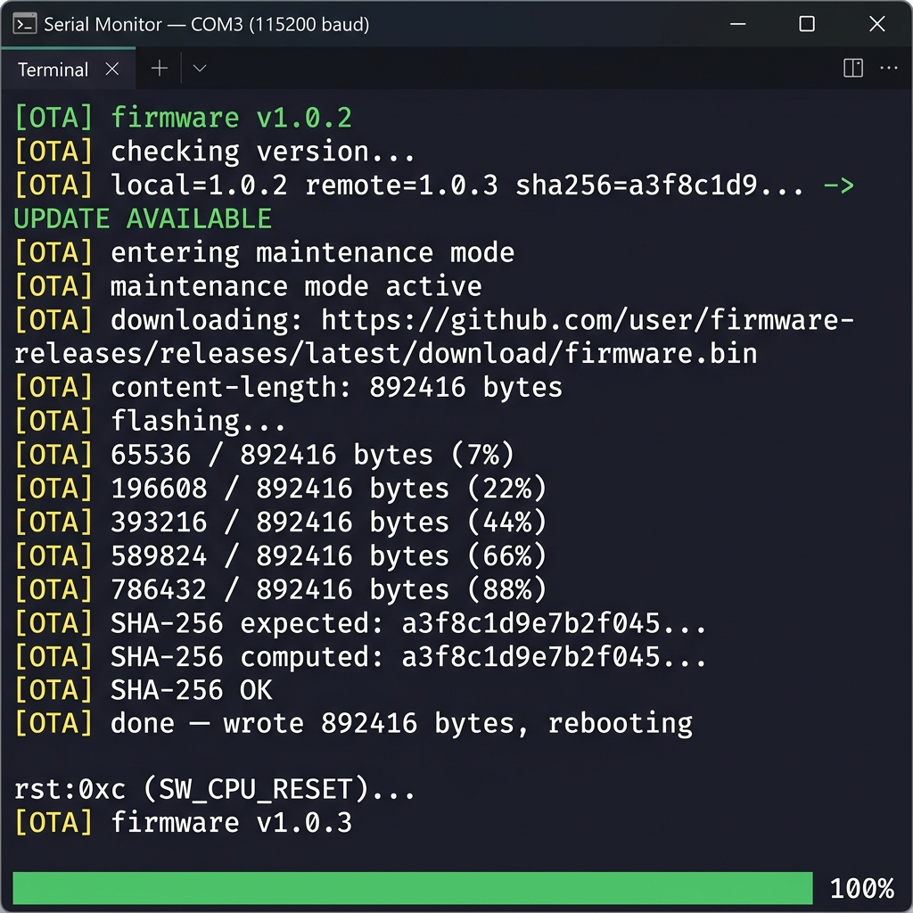
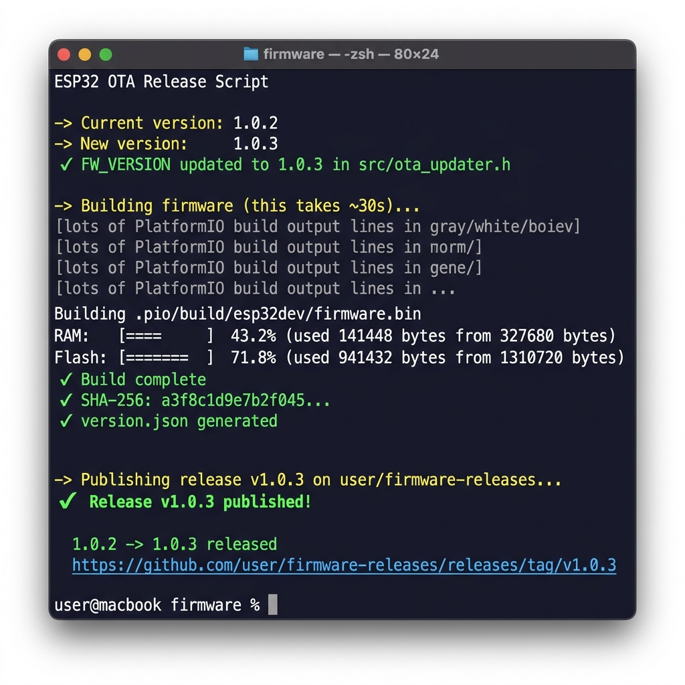
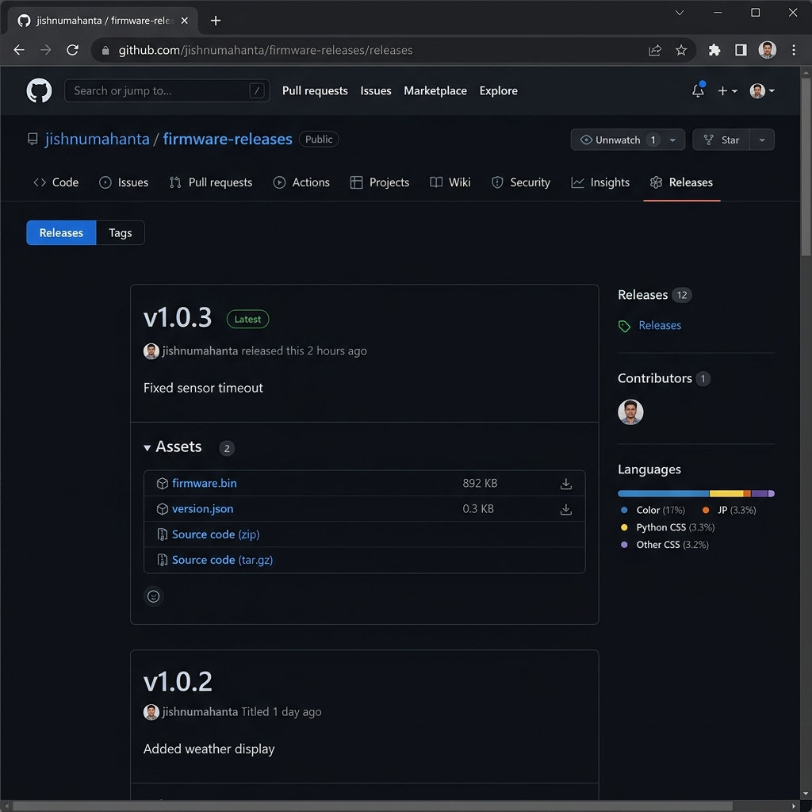
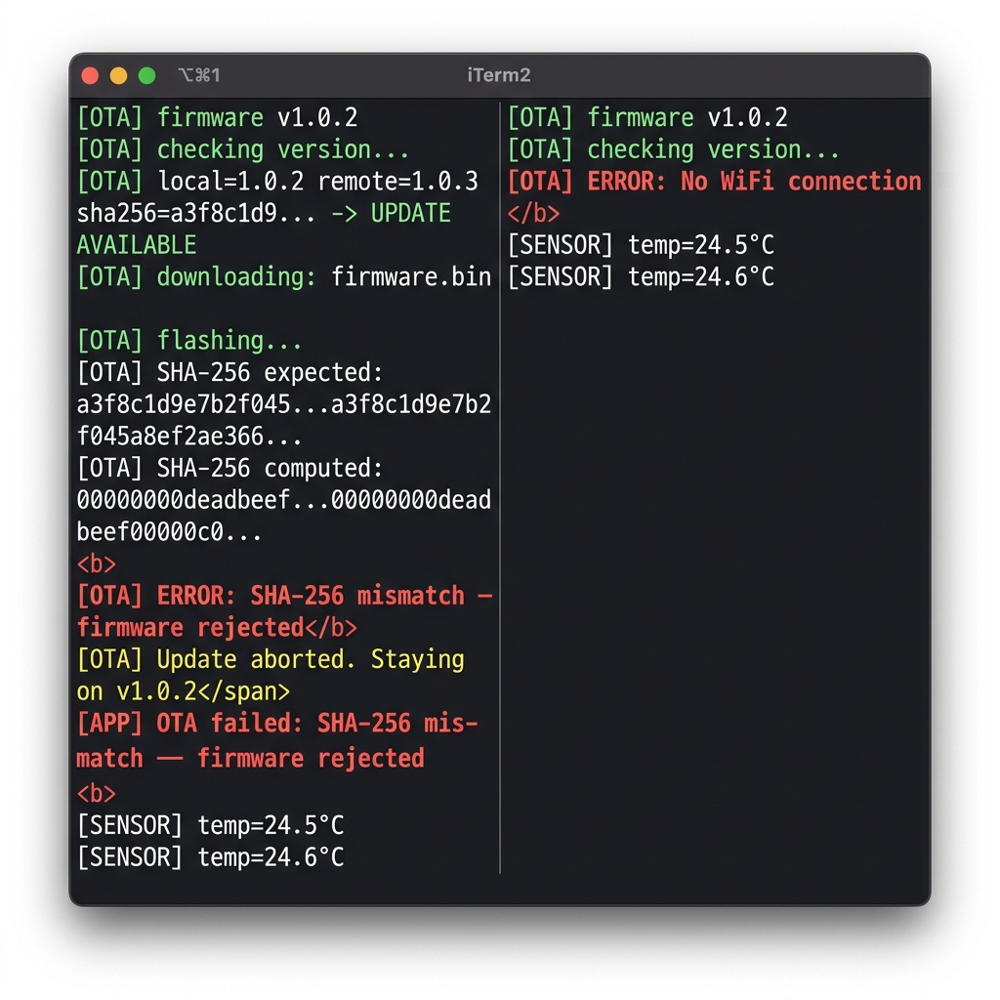

<div align="center">

# GitReleaseOTA

**Deployment infrastructure for ESP32 firmware — powered by GitHub Releases.**

Stream firmware OTA updates directly from GitHub Releases.  
SHA-256 integrity verification. FreeRTOS-safe. One-command release pipeline.

[](LICENSE)
[](https://platformio.org/lib/show/0/GitReleaseOTA)
[](https://www.arduino.cc/reference/en/libraries/)
[](https://github.com/jishnumahanta/GitReleaseOTA/releases/latest)
[](https://www.espressif.com/en/products/socs/esp32)

Built from production firmware powering [SMARTPlantMonitor](https://github.com/jishnumahanta) — an AI-powered ESP32-S3 IoT plant monitor.

</div>

---

## Install

**PlatformIO** — add to the `lib_deps` option of your `[env:]` section in `platformio.ini`:

```ini
lib_deps = jishnumahanta/GitReleaseOTA@^1.1.0
```

Or from the PlatformIO Core CLI:

```bash
pio pkg install --library "jishnumahanta/GitReleaseOTA@^1.1.0"
```

**Arduino IDE** — Sketch → Include Library → Add .ZIP Library, or clone this repository into `~/Documents/Arduino/libraries/`.

Then include it and configure it at runtime (works in both the Arduino IDE and PlatformIO):

```cpp
#include <GitReleaseOTA.h>   // (ota_updater.h still works)

otaBegin("your-username", "your-releases-repo", "1.0.0");
```

> **Upgrading from 1.0.x?** See the [CHANGELOG](CHANGELOG.md). Short version: `otaInit()` + `#define`s still work, but a release without `sha256` is now refused, `otaInstall()` requires a successful check first, and `OTA_VERSION_URL` / `OTA_BIN_URL` are gone.

---

## Why GitReleaseOTA?

| | ArduinoOTA | ElegantOTA | **GitReleaseOTA** |
|---|---|---|---|
| Transport | Local Wi-Fi | HTTP upload | **HTTPS GitHub CDN** |
| Custom server | ❌ Not needed | ✅ Required | **❌ Not needed** |
| SHA-256 integrity | ❌ | ❌ | **✅ Hardware-accelerated** |
| Signed releases | ❌ | ❌ | **✅ Optional ECDSA P-256** |
| Release automation | ❌ | ❌ | **✅ One command** |
| CI/CD friendly | ❌ | ❌ | **✅ `gh release create`** |
| Version comparison | String | String | **✅ Semantic (1.10.0 > 1.9.0)** |
| Production-grade | ❌ | Partial | **✅** |

> **The real value**: No custom OTA server. No manual uploads. One command and every device in the field updates itself — with SHA-256 integrity checking and, if you add a signing key, firmware that only *you* can publish.

---

## OTA Update Flow

```
  ┌─────────────────────┐
  │    ESP32 Device      │  Running firmware v1.0.2
  └──────────┬──────────┘
             │  otaCheckAsync()
             ▼
  ┌─────────────────────┐
  │  Fetch version.json  │  github.com/.../releases/latest/download/
  └──────────┬──────────┘
             │  Parse & compare versions (semver)
             │  1.0.3 > 1.0.2  → true
             │  Verify signature over "version:sha256"  (if a public key is set)
             ▼
  ┌─────────────────────┐
  │  UPDATE_AVAILABLE    │
  └──────────┬──────────┘
             │  otaInstall()
             ▼
  ┌─────────────────────┐
  │  Download firmware   │  Streamed over HTTPS, 1 KB chunks
  └──────────┬──────────┘
             │  SHA-256 computed in real-time (mbedTLS)
             ▼
  ┌─────────────────────┐
  │  SHA-256 Verify      │  Compare against version.json hash
  └──────────┬──────────┘
             │  ✅ Match     ❌ Mismatch → abort, stay on v1.0.2
             ▼
  ┌─────────────────────┐
  │  OTA Partition Flash │  Written to inactive app partition
  └──────────┬──────────┘
             │  Update.end(true) — marks new partition bootable
             ▼
  ┌─────────────────────┐
  │  ESP.restart()       │  Boots from new partition → v1.0.3
  └─────────────────────┘
```

---

## Release Pipeline

```
  Developer Machine                     GitHub                 ESP32 Devices
  ─────────────────                     ──────                 ─────────────
  ./release.sh patch "Fix crash"
       │
       ├─ Read FW_VERSION from header   "1.0.2"
       ├─ Bump version                  1.0.2 → 1.0.3
       ├─ Write back to header          #define FW_VERSION "1.0.3"
       ├─ pio run  (build firmware.bin)
       ├─ shasum -a 256 firmware.bin
       ├─ Sign "1.0.3:<sha256>"         (if OTA_SIGNING_KEY is set)
       ├─ Write version.json
       │    { "version": "1.0.3",
       │      "bin": "github.com/.../firmware.bin",
       │      "sha256": "a3f8c1...",
       │      "sig": "MEUCIQ...",
       │      "notes": "Fix crash" }
       │
       └─ gh release create v1.0.3 ──► GitHub Release
                                  firmware.bin ──► CDN
                                  version.json ──► CDN
                                                     │
                                          (next boot / scheduled)
                                                     │
                                  ESP32 otaCheckAsync() ◄────┘
                                  downloads & flashes v1.0.3
```

---

## Flash Partition Layout

```
  ESP32 Flash (4 MB)
  ┌──────────────────────────────────────────────────┐
  │  0x0000   Bootloader                             │
  ├──────────────────────────────────────────────────┤
  │  0x8000   Partition Table                        │
  ├──────────────────────────────────────────────────┤
  │  0x9000   NVS (Non-Volatile Storage)   20 KB     │
  ├──────────────────────────────────────────────────┤
  │  0xe000   OTA Data                      8 KB     │ ← tracks active slot
  ├──────────────────────────────────────────────────┤
  │  0x10000  app0 (ota_0)              1984 KB      │ ← ACTIVE: v1.0.2
  ├──────────────────────────────────────────────────┤
  │  0x200000 app1 (ota_1)              1984 KB      │ ← OTA writes here
  └──────────────────────────────────────────────────┘

  After Update.end(true):
  OTA Data flips → app1 becomes active at next boot
  app0 becomes the new inactive slot (next update target)
```

---

## OTA State Machine

```
            ┌─────────┐
            │OTA_IDLE │
            └────┬────┘
                 │ otaCheckAsync()
                 ▼
           ┌──────────┐
           │ CHECKING │
           └────┬─────┘
      ┌─────────┼──────────────────────────────┐
      │         │ version.json OK               │ error
      │         ▼                               ▼
      │  ┌─────────────┐           ┌──────────────────────┐
      │  │ UP_TO_DATE  │           │ ERROR_WIFI            │
      │  └─────────────┘           │ ERROR_HTTP            │
      │         │ update found      │ ERROR_PARSE           │
      │         ▼                  └──────────────────────┘
      │  ┌─────────────────┐
      │  │ UPDATE_AVAILABLE │
      │  └───────┬──────────┘
      │          │ otaInstall()
      │          ▼
      │  ┌─────────────┐
      │  │ DOWNLOADING  │──── stall / HTTP / truncated ──► ERROR_FLASH / ERROR_HTTP
      │  └──────┬──────┘
      │         │
      │         ▼
      │  ┌─────────────┐
      │  │  VERIFYING   │──── hash mismatch ──► ERROR_HASH
      │  └──────┬──────┘
      │         │ ✅
      │         ▼
      │  ┌─────────────┐
      │  │   SUCCESS    │──► ESP.restart()
      │  └─────────────┘
      │
      └──── retry after delay
```

---

## Serial Monitor Output

What you see on a successful OTA update:

```
[OTA] firmware v1.0.2
[OTA] checking version...
[OTA] local=1.0.2 remote=1.0.3 sha256=a3f8c1d9... -> UPDATE AVAILABLE
[OTA] entering maintenance mode
[OTA] maintenance mode active
[OTA] downloading: https://github.com/user/repo/releases/latest/download/firmware.bin
[OTA] content-length: 892416 bytes
[OTA] flashing...
[OTA] 65536 / 892416 bytes (7%)
[OTA] 196608 / 892416 bytes (22%)
[OTA] 393216 / 892416 bytes (44%)
[OTA] 589824 / 892416 bytes (66%)
[OTA] 786432 / 892416 bytes (88%)
[OTA] SHA-256 expected: a3f8c1d9e7b2f045...
[OTA] SHA-256 computed: a3f8c1d9e7b2f045...
[OTA] SHA-256 OK
[OTA] done — wrote 892416 bytes, rebooting

ets Jun  8 2016 00:22:57
rst:0xc (SW_CPU_RESET)...
[OTA] firmware v1.0.3      ← new firmware running
```



---

## Semantic Version Comparison

Many OTA systems compare versions as **strings**, which breaks at double-digit components:

```
String compare:  "1.10.0" < "1.9.0"  ← ❌ WRONG
Numeric compare: 1.10.0  > 1.9.0    ← ✅ CORRECT
```

GitReleaseOTA implements [semantic version](https://semver.org) precedence (`src/gro_core.cpp`, unit-tested on a host machine):

✅ `1.10.0 > 1.9.0` — numeric, not lexicographic  
✅ `2.0.0 > 1.99.99`  
✅ `1.0.0 == 1.0.0` — no spurious update  
✅ `v1.2.3 == 1.2.3` — optional leading `v`  
✅ `1.0.0-rc1 < 1.0.0` — pre-releases sort below the release; `1.0.0+build5 == 1.0.0`  
❌ Anything that isn't a version (`""`, `abc`, `1.2.3.4`) is rejected as `OTA_ERROR_PARSE` — it is never silently treated as `0.0.0`

---

## Features

- **GitHub Releases as OTA server** — no custom server, no infrastructure
- **SHA-256 integrity check** — computed while streaming through mbedTLS (hardware-accelerated where the chip supports it); a release without a hash is refused
- **Optional ECDSA P-256 signatures** — devices only accept firmware signed by your key, regardless of the network in between
- **Proper semantic versioning** — `1.10.0 > 1.9.0`, pre-releases, `v` prefix
- **Non-blocking version check** — FreeRTOS task on core 0, never stalls `loop()`
- **Thread-safe state** — `otaGetInfo()` / `otaGetState()` are safe from any task; concurrent checks/installs are refused instead of racing
- **Maintenance + failure callbacks** — stop I2S, sensors, LEDs before the flash, and restart them if it fails
- **Truncation-proof downloads** — a dropped connection is an error, not a "complete" image
- **Redirect following** — handles GitHub's multi-step redirect chain automatically
- **Atomic OTA** — bad hash/signature or mid-flash power loss leaves current firmware intact
- **Automated release script** — one command: bump → build → SHA-256 → sign → publish, safe to re-run after failures (`--dry-run` supported)

---

## Repository Structure

```
GitReleaseOTA/
├── src/
│   ├── GitReleaseOTA.h        # Header — include this in your project
│   ├── ota_updater.h          # Public API (GitReleaseOTA.h includes it)
│   ├── ota_updater.cpp        # ESP32 implementation (HTTP, flashing, state)
│   ├── gro_core.h / .cpp      # Pure logic: semver, JSON, SHA-256, signatures (host-testable)
├── examples/
│   ├── BasicOTA/
│   │   └── BasicOTA.ino       # Minimal working example
│   ├── FreeRTOSMultiTask/
│   │   └── FreeRTOSMultiTask.ino
│   └── ScheduledOTA/
│       └── ScheduledOTA.ino
├── tests/                     # Host unit tests + release.sh end-to-end tests (see Testing)
├── .github/workflows/ci.yml   # Runs the tests and builds every example
├── release.sh                 # Release automation script
├── CHANGELOG.md
├── library.properties / library.json / keywords.txt
└── README.md
```

---

## Setup

### Step 1 — Two GitHub repositories

- **Source repo** — your firmware code (private or public)
- **Releases repo** — hosts OTA assets (**must be public** so devices can download)

The releases repo can be empty — `release.sh` bootstraps it on first run.

### Step 2 — Install dependencies

```bash
brew install gh jq && gh auth login
# PlatformIO: `pio` on your PATH, or at ~/.platformio/penv/bin/pio
```

### Step 3 — Configure `release.sh`

Edit the variables at the top of `release.sh`, or export them:

```bash
GITHUB_USER="your-username"
GITHUB_REPO="your-releases-repo"
VERSION_FILE="src/version.h"     # YOUR firmware file with: #define FW_VERSION "1.0.0"
BUILD_ENV="esp32dev"
FIRMWARE_PATH=".pio/build/${BUILD_ENV}/firmware.bin"
```

`VERSION_FILE` must contain exactly one real `#define FW_VERSION "x.y.z"` line (comments don't count). The script refuses to run on a dirty git tree, and restores the file if anything fails before the release is published.

### Step 4 — (Recommended) Create a signing key

```bash
./release.sh keygen            # writes ota_signing_key.pem (git-ignored) and prints the public key
```

Paste the printed `OTA_PUBLIC_KEY` into your firmware (Step 5) and release with `OTA_SIGNING_KEY=ota_signing_key.pem ./release.sh patch "notes"`. Back the key up somewhere safe: devices that trust it will reject releases signed by any other key.

### Step 5 — Add to your firmware

```cpp
#include <WiFi.h>
#include <GitReleaseOTA.h>

const char* FW_VERSION_STR = "1.0.0";   // keep in sync with FW_VERSION used by release.sh
// const char* OTA_PUBLIC_KEY = "-----BEGIN PUBLIC KEY-----\n...";   // from ./release.sh keygen

void beforeFlash()      { i2sStop(); ledOff(); }
void afterFailedFlash() { i2sStart(); ledOn(); }

void setup() {
  Serial.begin(115200);
  WiFi.begin("SSID", "PASSWORD");
  while (WiFi.status() != WL_CONNECTED) delay(500);

  otaBegin("your-username", "your-releases-repo", FW_VERSION_STR);
  // otaSetPublicKey(OTA_PUBLIC_KEY);
  otaSetMaintenanceCallback(beforeFlash);
  otaSetFailureCallback(afterFailedFlash);
  otaCheckAsync();
}

void loop() {
  if (otaGetState() == OTA_UPDATE_AVAILABLE) {
    String err = otaInstall();
    if (!err.isEmpty()) Serial.println("[OTA] failed: " + err);
  }
  delay(10);
}
```

For FreeRTOS tasks touching hardware, add to each task loop:

```cpp
if (g_otaInProgress) { vTaskDelay(pdMS_TO_TICKS(50)); continue; }
```

> **Stack size:** `otaInstall()` does the TLS handshake on the *calling* task's stack. Call it from a task with at least ~10 KB (the Arduino `loop()` task's default 8 KB works; a 4 KB task will overflow).

**Compile-time configuration still works.** If you define `FW_VERSION`, `OTA_GITHUB_USER` and `OTA_GITHUB_REPO` (before including the header, or as PlatformIO `build_flags`), `otaInit()` calls `otaBegin()` for you:

```ini
build_flags =
    -D FW_VERSION='"1.0.0"'
    -D OTA_GITHUB_USER='"your-username"'
    -D OTA_GITHUB_REPO='"your-releases-repo"'
```

---

## Releasing a New Version

```bash
./release.sh patch "Fixed sensor timeout"
./release.sh minor "Added weather display"
./release.sh major "Rewrote audio pipeline"
```

The script automatically: reads version → bumps → writes back → builds → SHA-256 → (signs) → generates `version.json` → creates GitHub Release → commits the version bump locally (not pushed; `--no-commit` to skip).

| Flag / variable | Effect |
|---|---|
| `--dry-run` | Build and generate `version.json`, publish nothing, leave your files untouched |
| `--allow-dirty` | Don't require a clean git tree |
| `--no-commit` | Don't commit the version bump after publishing |
| `OTA_SIGNING_KEY=key.pem` | Sign the release (see Step 4) |
| `./release.sh keygen [file]` | Create a signing key and print the public key as a C string |

Safety properties: release notes are JSON-escaped (quotes and newlines are fine), an existing tag is never overwritten, and the releases repo is only bootstrapped when GitHub says it is empty. Any other API failure (network, auth, rate limit) aborts without touching the repo.



---

## GitHub Releases

Each release automatically uploads `firmware.bin` and `version.json` to GitHub Releases, which acts as the CDN for all devices in the field:



---

## API Reference

```cpp
// Configuration (call before otaCheckAsync)
bool        otaBegin(const char* user, const char* repo, const char* currentVersion);
void        otaInit();                           // legacy: otaBegin() from FW_VERSION / OTA_GITHUB_USER / OTA_GITHUB_REPO macros
void        otaSetPublicKey(const char* pem);    // ECDSA P-256 public key; makes a valid signature mandatory
void        otaSetCACert(const char* pem);       // optional TLS certificate validation
void        otaAllowUnverified(bool allow);      // allow releases without sha256 (not recommended)

// Callbacks
void        otaSetMaintenanceCallback(void(*)());                   // before flashing: stop hardware
void        otaSetFailureCallback(void(*)());                       // install failed: restart hardware
void        otaSetProgressCallback(void(*)(size_t written, size_t total));

// Operation
void        otaCheckAsync();                     // non-blocking version check
String      otaInstall();                        // blocking: download → verify → flash → reboot; returns an error message
OtaState    otaGetState();                       // thread-safe
OtaInfo     otaGetInfo();                        // thread-safe copy: version, sha256, notes, updateAvailable, signatureVerified
const char* otaStateStr(OtaState s);
extern volatile bool g_otaInProgress;            // check in your FreeRTOS tasks

// Rollback support
bool        otaIsPendingVerify();
bool        otaMarkValid();
```

`otaInstall()` only runs after a check found an update (`otaGetInfo().updateAvailable`); it returns `"OTA busy …"` if a check or install is already running.

### OtaState Values

| State | Meaning |
|---|---|
| `OTA_IDLE` | No check performed yet |
| `OTA_CHECKING` | Version check in progress |
| `OTA_UPDATE_AVAILABLE` | Remote version is semantically newer |
| `OTA_UP_TO_DATE` | Already on latest version |
| `OTA_DOWNLOADING` | Streaming firmware.bin |
| `OTA_VERIFYING` | SHA-256 comparison |
| `OTA_SUCCESS` | Flash complete — device reboots |
| `OTA_ERROR_WIFI` | No WiFi connection |
| `OTA_ERROR_HTTP` | HTTP request failed |
| `OTA_ERROR_PARSE` | `version.json` missing or malformed |
| `OTA_ERROR_FLASH` | Write to OTA partition failed |
| `OTA_ERROR_NO_SPACE` | Not enough flash for firmware |
| `OTA_ERROR_HASH` | SHA-256 mismatch or missing — firmware rejected |
| `OTA_ERROR_SIGNATURE` | A public key is set and `version.json` has no valid `sig` — update rejected before any download |
| `OTA_ERROR_CONFIG` | `otaBegin()` not called, or called with an invalid user/repo/version |

---

## Failure Recovery

| Scenario | Behaviour |
|---|---|
| Power loss during flash | Active partition untouched — device boots into previous firmware |
| SHA-256 mismatch | `Update.abort()` called immediately — binary discarded, state → `OTA_ERROR_HASH` |
| Invalid / missing signature | Rejected at check time, nothing is downloaded — state → `OTA_ERROR_SIGNATURE` |
| Connection drops mid-download | Detected (`written != Content-Length`) — `Update.abort()`, state → `OTA_ERROR_HTTP` |
| Any failed install | `g_otaInProgress` is cleared and your failure callback runs so you can restart what the maintenance callback stopped |
| No WiFi at check time | State → `OTA_ERROR_WIFI` — call `otaCheckAsync()` again after reconnect |
| HTTP failure | Binary never downloaded — check repo is public and user/repo names are correct |
| Partition too small | `Update.begin()` fails → `OTA_ERROR_NO_SPACE` — fix `partitions.csv` |
| Corrupt `version.json` | State → `OTA_ERROR_PARSE` — binary never downloaded, devices stay on current version |



---

## Rollback Roadmap

The library exposes the ESP-IDF rollback hooks:

```cpp
if (otaIsPendingVerify()) {      // we just booted a freshly flashed image
  if (selfTestPasses()) otaMarkValid();   // confirm it — otherwise the bootloader may roll back
}
```

**Important:** the bootloader only rolls back automatically when it was built with `CONFIG_APP_ROLLBACK_ENABLE`. Stock Arduino-ESP32 builds do **not** enable it, so there `otaMarkValid()` is harmless but nothing rolls back by itself — use it with a custom/ESP-IDF bootloader, and in the meantime keep a watchdog as a safety net. This API has not been exercised on rollback-enabled hardware.

---

## Partition Requirements

```csv
# Name,   Type, SubType,  Offset,   Size,     Flags
nvs,      data, nvs,      0x9000,   0x5000,
otadata,  data, ota,      0xe000,   0x2000,
app0,     app,  ota_0,    0x10000,  0x1F0000,
app1,     app,  ota_1,    0x200000, 0x1F0000,
```

```ini
board_build.partitions = partitions.csv
```

> **Tip**: For ESP32-S3 with 8 MB flash, allocate `0x3C0000` per OTA slot to accommodate large LVGL/WiFi/BLE builds.

---

## Examples

### FreeRTOS Multi-Task

```cpp
#include <WiFi.h>
#include <GitReleaseOTA.h>

void sensorTask(void*) {
  for (;;) {
    if (g_otaInProgress) { vTaskDelay(pdMS_TO_TICKS(50)); continue; }
    // read sensor ...
    vTaskDelay(pdMS_TO_TICKS(100));
  }
}

void beforeFlash()      { i2sStop(); ledOff(); }
void afterFailedFlash() { i2sStart(); }

void setup() {
  WiFi.begin("SSID", "PASSWORD");
  while (WiFi.status() != WL_CONNECTED) delay(500);
  xTaskCreatePinnedToCore(sensorTask, "sensor", 4096, nullptr, 2, nullptr, 1);
  otaBegin("your-username", "your-releases-repo", "1.0.0");
  otaSetMaintenanceCallback(beforeFlash);
  otaSetFailureCallback(afterFailedFlash);
  otaCheckAsync();
}

void loop() {                       // Arduino's loop task has enough stack for otaInstall()
  if (otaGetState() == OTA_UPDATE_AVAILABLE) otaInstall();
  delay(100);
}
```

The full version in [`examples/FreeRTOSMultiTask`](examples/FreeRTOSMultiTask/FreeRTOSMultiTask.ino) runs the install from a dedicated 12 KB task.

### Scheduled OTA (Every 6 Hours)

```cpp
unsigned long lastCheck = 0;
const unsigned long INTERVAL = 6UL * 60 * 60 * 1000;

void loop() {
  if (millis() - lastCheck > INTERVAL) {
    otaCheckAsync();
    lastCheck = millis();
  }
  if (otaGetState() == OTA_UPDATE_AVAILABLE) {
    if (!otaInstall().isEmpty()) lastCheck = millis();   // failed: wait a full interval
  }
  delay(100);
}
```

---

## Security Notes

What each mechanism does and does not protect against:

- **SHA-256 alone is an integrity check, not authentication.** The expected hash is downloaded from the same place as the firmware. Against corruption it is sufficient; against someone who can intercept or redirect the connection (rogue Wi-Fi, DNS hijack) it is not, because they can serve a malicious binary *and* its hash. By default the TLS connection is encrypted but the server certificate is **not validated** (`setInsecure()`), and the library prints a warning saying so.
- **Signatures fix that.** Run `./release.sh keygen`, put the public key in your firmware with `otaSetPublicKey()`, and sign releases with `OTA_SIGNING_KEY`. The device then accepts a release only if `version.json` carries an ECDSA P-256 signature over `"<version>:<sha256>"` made with your private key. Since the hash covers the binary, only firmware you signed can be installed — even over a hostile network. Keep the private key secret and backed up (it is git-ignored by default); if it is lost, devices that trust it can't be updated to anything signed with a new key.
- **TLS certificate validation (optional).** `otaSetCACert(pem)` validates the server. Note that GitHub serves downloads from several hosts (`github.com`, then a `*.githubusercontent.com` redirect), which can chain to different roots and change over time, so pinned roots need maintenance. Signatures avoid that dependency, which is why they are the recommended mechanism.
- **Downgrades and revocation.** Only a strictly newer version is installed, so replaying an old signed release does nothing. Signed releases are never revoked, though: any validly signed, newer version will install. If you publish a bad release, fix it by publishing a higher version, not by deleting it.
- **Unverified releases are refused.** A `version.json` without `sha256` is rejected unless you call `otaAllowUnverified(true)`.
- **`bin` URL.** Must be `https://`. With a public key set it cannot be used to substitute firmware, since the signed hash must still match.
- **OTA partition**: Targets `U_FLASH` (inactive app partition). LittleFS / SPIFFS is untouched.
- **Private repositories** are not supported — devices download anonymously, so the releases repo must be public (embedding a GitHub token in firmware is a bad idea). Keep your source in a separate, private repo.

---

## Testing

```bash
./tests/run_host_tests.sh   # semver, JSON parsing, SHA-256, ECDSA signatures (needs mbedTLS + openssl; brew install mbedtls)
./tests/test_release.sh     # release.sh end to end with stubbed gh/pio (needs jq + openssl)
```

CI (`.github/workflows/ci.yml`) runs both plus a PlatformIO build of every example for ESP32 and ESP32-S3. The HTTP/flash path in `ota_updater.cpp` needs real hardware and a GitHub release to exercise; it is compile-checked but not covered by automated tests.

---

## License

MIT — use freely, modify as needed.

---

<div align="center">

Built with ❤️ for embedded engineers who ship to production.

**[GitHub](https://github.com/jishnumahanta/GitReleaseOTA)** · **[Issues](https://github.com/jishnumahanta/GitReleaseOTA/issues)** · **[SmartPot](https://github.com/jishnumahanta)**

</div>
